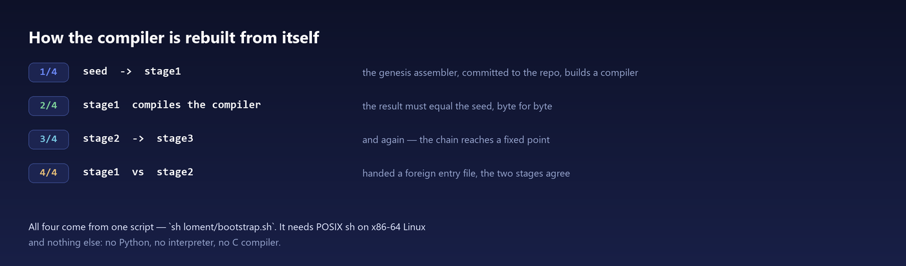
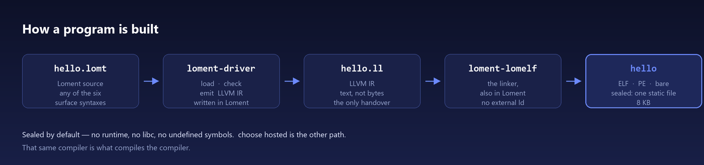
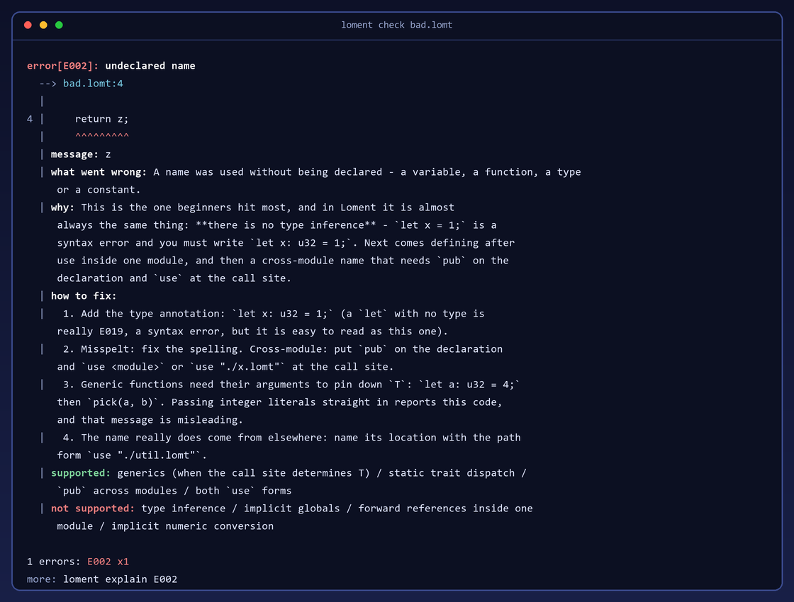

<p align="center">
  
</p>

<p align="center">
  <a href="https://github.com/FujoJTOP/loment/actions/workflows/gate.yml"></a>
  <a href="https://github.com/FujoJTOP/loment/releases/latest"></a>
  <a href="LICENSE"></a>
  <a href="https://discord.gg/rGw7NRNU"></a>
</p>

<p align="center">
  <b>A systems programming language.</b><br>
  Native x86-64 — Linux ELF, Windows PE, or bare metal.<br>
  <b>Sealed</b> by default: no runtime, no libc, no undefined symbols.
  <b>Hosted</b> when you say so: real libc and shared libraries.
</p>

<p align="center">
  <a href="https://github.com/FujoJTOP/loment/releases/tag/v0.1.4.5-quickfix"><b>Download 0.1.4.5 QuickFix</b></a> ·
  <a href="QUICKSTART.md">Quick start</a> ·
  <a href="docs/manual/index.md">Manual</a> ·
  <a href="https://loment.fandom.com/">Wiki</a> ·
  <a href=".claude/skills/loment/SKILL.md">Language guide</a> ·
  <a href="loment/examples/">Examples</a> ·
  <a href="CONTRIBUTING.md">Contributing</a> ·
  <a href="https://fujojtop.github.io/loment-site/">Site</a> ·
  <a href="https://github.com/FujoJTOP/loment/issues">Issues</a>
</p>

Loment compiles to native x86-64 executables — Linux ELF, Windows PE, or a freestanding
object for bare metal. **What goes into one is the program's decision, and the build records
it.** `choose sealed`, the default, is an artifact with no runtime, no libc and no undefined
symbols. `choose hosted` — the path to real libc and shared libraries — **is not finished and a
release build refuses it**; the development channel is where it is being built, and an artifact
that carries undefined symbols is refused by the linker by default ([docs/222](docs/222-lompi-020-foreign-libs.md)
sec 4.5). The
toolchain is itself written in Loment and needs no Python to run. Its own syntax is
Rust-flavored, and the same program can be written in six more: C, C++, Java, C#, Go or Python.

Installing and running needs **no Python, no clang and no WSL** — the package is native
binaries plus the standard library. `loment run hello.lomt` and you are done.

## The Loment Language Standard — `LLS`

The language has a **named, citable standard**: **LLS**, the *Loment Language Standard*.

> **[`standard/LLS.md`](standard/LLS.md)** — the standard, with its version in its own front matter

It is a **frame, not a second copy of the language.** The repository's rule is that the
authoritative copy of anything exists in exactly one place, so the standard states **no language
rules of its own**. It does two things:

| | |
|---|---|
| **Fixes the surface** | What is frozen, and what changing it costs. |
| **Decides conformance** | And says plainly that **the conformance suite decides** — not the document, and not any implementation. |

**Loment is defined by its switches, not by what it lacks.** Every subsystem the language can have
is one of them: which layer the program may use, who reclaims memory, whether the artifact carries
a runtime, whether it has ports to the world, and which execution model it is for. A program sets
each at most once, in its root unit, and the build records it.

The defaults are conservative so that **writing nothing changes nothing** — `sealed`, `no_runtime`,
`no_vm`, `gc_manual` are what you get when you say nothing, which is why the paragraph above can
describe a program that has no runtime, no libc and no ports. That is a property of the defaults,
not a claim about the language: the same switches go the other way, and each of them is a
**position a program states** rather than a limit it works around.

The standard's version **is** the version of the surface it defines — one number, not two, because
a separate edition axis would require a table mapping editions to language versions, and that
table would be a second source of truth.

> **A limitation, stated rather than discovered:** the standard is written in English, and most of
> what it normatively references — [`docs/143`](docs/143-l1-loment-v0.md) (the language),
> [`docs/146`](docs/146-loment-capability-semantics.md) (capability semantics),
> [`docs/158`](docs/158-loment-freeze.md) (the frozen surface) — is written in Chinese.

## Status

`0.1.4.5 QuickFix`. **It ships as a package** — the
[Loment 0.1.4.5 QuickFix](https://github.com/FujoJTOP/loment/releases/tag/v0.1.4.5-quickfix) release
carries a Linux `tar.gz`, a Windows `zip`, a Windows `setup.exe` installer and the agent-guide zip.
You can also build the toolchain from a checkout ([QUICKSTART.md](QUICKSTART.md)).

> [!NOTE]
> **On Windows, double-click the `setup.exe` and a window walks you through it** — where to install,
> the switches as checkboxes, the install streaming as it runs, and a receipt at the end that waits
> for you to close it. The command line is unchanged: `install.cmd` with any argument (and
> `install.ps1` directly) behaves exactly as before.
>
> Two older installers are worth knowing about. **0.1.4's `setup.exe` installs nothing** — it could
> not find the script it had unpacked, and that asset is not being rebuilt, because rebuilding would
> change the bytes under a version number already in the wild
> ([#117](https://github.com/FujoJTOP/loment/issues/117)); use the `zip`. **0.1.4.5's `setup.exe`
> does install** — it just did it invisibly, which is what this release fixes. You do not need to
> reinstall if it already worked for you.

The toolchain is **self-hosted at run time**: it compiles and runs with no Python and no
libc. The **development side is not**, and 0.1.4.5 ships before that gap closed:
`tools/` still holds the reference implementation (`tools/lomentc.py` and friends) and the
Python test suites ([docs/189](docs/189-full-selfhosting.md)). The work is done one criterion
at a time — each Python criterion gains a Loment twin, and the two must agree byte for byte
before the Python side can be retired. Until that finishes, both copies are in the repository
on purpose, and "the repository contains only Loment" is not yet true.

What **this** release does and does not include is in the
[0.1.4.5 release notes](.github/release-notes/v0.1.4.5.md); what 0.1.4 included, listed item by
item and audited, is in [docs/202](docs/202-loment-014-release-gate.md).

The language surface is frozen — [docs/158](docs/158-loment-freeze.md) says what changing it
costs — and the implementation is not.



## A first program

```rust
module hello

fn _start() {
    let s: str = "hello from Loment\n";
    syscall4(1, 1, str_ptr(s) as u64, str_len(s) as u64);
    syscall4(60, 0, 0, 0);
}
```

```console
$ loment run hello.lomt
hello from Loment
```

`_start` is the entry point, because a sealed artifact has no runtime to call one for you, and
output goes through the `write` system call, because there is no `printf`. A `hosted` artifact
is a C-runtime program instead — its entry point is `fn main() -> u32`, and that is one of the
things the port setting decides. [QUICKSTART.md](QUICKSTART.md)
takes it from here: getting the sources, building the toolchain, and `loment run` / `build` /
`check` / `ir`.



## What it is for

Most languages answer "what can this program do?". Loment is arranged around a narrower
question — **who can run what, in what scope, and can that be settled without reading the
source?** Three things carry it:

| | |
|---|---|
| **Capability domains** | `capability blk : disk[0..4]` declares the range a unit may reach and `guard blk(i);` checks the index against it — at compile time when the index is a literal, otherwise at run time, where an out-of-range index traps. [docs/146](docs/146-loment-capability-semantics.md) states the boundary rather than glossing it: a guard bounds the *index*, not the *subject*. |
| **Potato form objects** | Every unit exports a declared, machine-readable summary of what it contains and what it reaches, judged by two independent validators — so "what can this touch" is answerable without reading the source. [docs/147](docs/147-potato-v1-spec.md) |
| **A compat layer** | Ten languages, two mechanisms: C, C++, Rust and Zig behind the C ABI; Go, Python, Java, JavaScript, Perl and Lua over a process bridge. Where the boundary sits is worth stating precisely. `--link` takes a **self-contained** object (relocations are applied, and objects may reference each other); one that carries **undefined symbols** — `printf`, `malloc` — is **refused by default**. `choose hosted`, the dimension that reaches real libraries, is **not available in a release build**: that path is unfinished, so the release toolchain refuses `choose hosted` and keeps that door shut, while the development channel is where it is built and exercised — the criteria there link libstdc++ and libz and embed CPython. What is **not** there either is the **library system** — lompi still installs `.lomt` sources only, so a real C library is not yet an installable dependency, and that is what [docs/222](docs/222-lompi-020-foreign-libs.md) is building. [docs/173](docs/173-loment-ffi.md) is the ledger. |

The rest of the language exists to keep that question answerable. The core stays small; what
grows is the layer around it ([docs/175](docs/175-loment-014-direction.md)).

## What else is different

| | |
|---|---|
| **A standard library, imported one module at a time** | `lompi/store/` ships with the toolchain: `std` (127 modules — vectors, maps, text, big integers, floats, hashing, compression) and `host` (files, argv, directories). `use vec`, `use map`, `use fs`. The package facade `use std` also works, but pulls all 127 modules into one unit — emitted symbols are flat, so that is slow and collision-prone. Prefer per-module. |
| **Can be written in six other syntaxes** | C, C++, Java, C#, Go, Python. Only the spelling changes; the meaning is always Loment's — it is a syntax, not a semantics, and each front end says so on its first line. Declaring it in the file (`choose write grammar`) is not wired into the compiler yet; the translators are. [docs/188](docs/188-grammar-declaration.md) · [docs/179](docs/179-multisyntax-frontends.md) |
| **A project mode, not a crate attribute** | `choose` has **five** dimensions: which layer the program may use (`std` / `no_std`), the reclamation tier, whether the artifact may carry a runtime, whether it may reach outside itself (`sealed` / `hosted`), and which execution model it is for (`vm` / `no_vm`). Each is written at most once, in the root unit, and each becomes a property of the whole program: a contradictory pair is refused, and a form object carries the setting. The fifth is the newest and does the least — in a **release build `choose vm` is a compile error**, and the development channel that accepts it produces an artifact byte-identical to `no_vm`. [docs/180](docs/180-std-core.md) · [docs/231](docs/231-lvm-channel-and-vm-dimension.md) |
| **Reports errors from a separate program** | The compiler emits structured diagnostics; `lomenterr` adds the title, the location and how to fix it, so the compiler carries no message table of its own. [docs/182](docs/182-lomenterr-and-choose-switches.md) |
| **Everything is customizable** | The source suffix, the command surface (`loment-<name>` on `PATH`; official commands always win), the libraries (a directory whose identity is a content hash), and the toolchain itself. No registry — the extension points are files on disk. |

That last row, in full — the report you actually read when a line does not compile. The
compiler emitted a code and a position; everything below `message:` came from `lomenterr`:



## Documentation

| | |
|---|---|
| `.claude/skills/loment/SKILL.md` | The language guide: syntax, built-ins, error codes, and the deviations from Rust. Self-contained, shipped inside the package (`loment skill --print`), and the fastest way in. |
| `loment/examples/tour.lomt` | The whole language in one file, with commentary (`loment example tour`). |
| `docs/manual/` | The generated manual: specifications, plus a page per example. |
| [Loment Wiki](https://loment.fandom.com/) | The language, the toolchain and the ecosystem as a browsable wiki, plus where the project is going. |
| `docs/143-l1-loment-v0.md` · `docs/146` · `docs/158` | The specification, capability semantics, and what is frozen. |
| `docs/173` · `docs/188` · `docs/189` | The three long-running threads: the compat layer, multi-syntax, and full self-hosting. |
| `docs/` | Design and measurement records, numbered by document. Most are written in Chinese. |
| [FujoJTOP/lompi](https://github.com/FujoJTOP/lompi) | The package manager. |

## Repository layout

| | |
|---|---|
| `loment/selfhost/` | The compiler. It is written in Loment. |
| `loment/tools/` | CLI, formatter, documentation generator, language server, linker, error reporter — and the Loment-side criteria that mirror `tools/`. |
| `loment/lib/` | Core library modules: `mem`, `num`, `json`, `sha256`, `proc`; plus `lumtui`, a terminal UI library ([docs/196](docs/196-lumtui.md)). |
| `lompi/store/` | The standard library, shipped with the toolchain: `std` (127 modules) and `host` (syscalls, files, argv, directories). One `use` per module — `use vec`, `use map`, `use fs`. |
| `loment/examples/` | 34 example programs. |
| `lom/` | Interface layer: one declaration source that generates constants and decoders for other languages. |
| `lompi/` | The package manager, written in Loment. |
| `editors/` | Editor support: VS Code and Vim. |
| `tools/` | The reference implementation and the Python test suites. Full self-hosting is what removes them — see Status. |
| `docs/` | Design and measurement records. |

## How this is built

Loment is developed with AI coding agents in the loop, and says so: `CLAUDE.md` and
`AGENTS.md` at the root are the working conventions, and the language guide sits where agents
are configured to look for it — the same file ships in the package as `loment skill --print`.
What that buys is less the tooling than the discipline around it: a change here is checked by
a program rather than by a reviewer's memory. Two implementations of the language surface must
agree byte for byte, every claim in `docs/` is tied to a criterion, and those criteria are
what keep the claims on this page honest.

## Getting help and contributing

Ask in an [issue](https://github.com/FujoJTOP/loment/issues) or on
[Discord](https://discord.gg/rGw7NRNU) — questions are as welcome as bug reports. Loment is
developed in this repository; the working conventions, including how a change is checked
before it lands, are in `AGENTS.md`.

## License

The **Loment-Open License** — the MIT License plus two conditions: source derived from Loment
must credit that base, and the name "Loment" is reserved. File extensions and syntax are free:
you may build a different language from this source without `.lomt` or `.lom`. See
[LICENSE](LICENSE).
